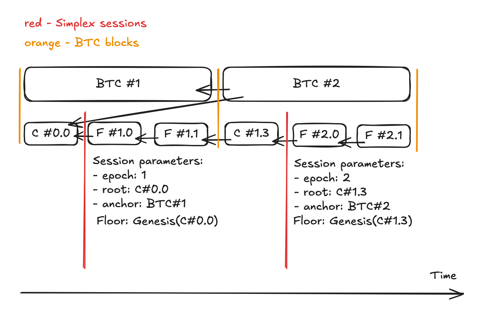

# BFT

This document describes the BFT component of Flame's consensus protocol.

Simplex has been selected as the consensus algorithm, specifically the
[Commonware implementation](https://github.com/commonwarexyz/monorepo/tree/main/consensus). No specific commit has been
selected, as the implementation is still under development and further improvements are expected.

However, neither the [original Simplex protocol](https://simplex.blog/) nor the Commonware implementation meets Flame's
specific requirements. This document describes the changes needed to use Simplex in Flame's consensus protocol.

## Running Commonware

This section describes the requirements for running Commonware Simplex in Flame.

### Sessions

Whenever the validator set changes, whether in membership or voting weights, a new `simplex::Engine` must be created
(referred to below as a **session**). The validator set is expected to change with every Bitcoin block, so a new session
is created for each Bitcoin block to maintain consistency.

Each session must have:

- A unique signing namespace
- A unique P2P channel namespace
- A unique journal partition

The following diagram shows how sessions relate to Bitcoin blocks:



#### Session Descriptor

Sessions must be created under the same preconditions across nodes, so nodes must determine the current BFT state
deterministically. To ensure this:

1. The Simplex epoch equals the height of the latest known canonical Bitcoin block.
2. The signing namespace contains the session identifier, which is the hash of the unique session descriptor defined
   as follows:

```rust
struct SessionDescriptor {
    protocol_version: u32,
    network_id: NetworkId,
    root: CoreBlockTip,
    validator_set_hash: Hash,
    anchor_btc_hash: BtcBlockHash,
}

type SessionId = Hash; // H(encode(descriptor))
```

The fields are:

- `protocol_version`: `0`.
- `network_id`: the network ID.
- `root`: the latest core block (not yet finalized), created as the last block of the previous epoch.
- `validator_set_hash`: the hash of the validator set (see below).
- `anchor_btc_hash`: the hash of the Bitcoin block whose height was used to determine the current epoch.

The resulting `SessionId` must be used to determine the session's signing namespace.

#### Session Lifecycle

When a session is created, its epoch is determined and its descriptor is constructed as follows:

- `root` is the core block from the previous session (see below). For the initial epoch, the genesis block is used as
  the root. If a reorg occurs or `root` is unknown to the node (e.g., it was produced outside the BFT rules), the root
  and its entire history must be retrieved from other nodes.
- `validator_set_hash` is constructed as described in the section below.
- `anchor_btc_hash` is the hash of the Bitcoin block whose height was used to determine the current epoch.

When a node receives a new Bitcoin block, it MUST stop signing blocks for the current epoch unless the proposed block
is a core block. Once the proposed core block is finalized, a new session starts with the parameters described above.
The proposed core block must have a target height equal to the current Simplex epoch + 2.

Some nodes may accept the core block as valid, while nodes that have not yet received the Bitcoin block may reject it.
However, a valid Finalization certificate may cause a node to accept the block despite its earlier local rejection
(see [Finalization Certificates Override Local Validation](#finalization-certificates-override-local-validation)).

In the current model, this process continues until the core block is finalized. This approach has known flaws (see
Discussion).

### Validator Set

The validator set contains the following information about each validator:

1. The validator key, obtained from the P2WSH script revealed on-chain.
2. The validator's consensus weight, equal to its minting power in the minting algorithm.

The validator's identity is its validator key, obtained from the P2WSH script revealed after its first endorsement.
The validator uses this key to sign consensus messages, and other validators use it to verify those messages.

> To participate in validation, a validator must submit at least one endorsement on the Bitcoin chain.

A node MUST store all validator keys revealed on the Bitcoin chain and MUST NOT delete them unless a reorg occurs.
In that case, the node MUST delete the validator keys revealed in the discarded blocks.

If a validator's key has not been revealed by the Bitcoin block identified by `anchor_btc_hash`, the validator MUST NOT
be included in the validator set, as its key is still unknown at that point in the chain's history.

> It is currently unclear whether this approach is sound: some forms of manipulation may violate the rules for
> revealing validator keys. This needs to be investigated and tested.

Validator membership and consensus weights are determined using `anchor_btc_hash` from the session descriptor. They
remain fixed throughout a Simplex session, since any change requires a new Bitcoin block, which triggers a new session.

Consensus weight is calculated per validator key. Burns can have different Flame predicates while sharing the same
validator key, so burns MUST be grouped by validator key rather than by P2WSH hash or Flame predicate.

#### Empty Validator Set

TODO: Address this minor edge case.

### Signing Scheme

The signing scheme must be `scheme::ed25519`.

### Leader Election

Leader election must be pseudorandom and proportional to validator weights. The election outcome must be unpredictable
until the Bitcoin block used as the randomness source is published. Once that block is published, the leader schedule
for the entire epoch becomes deterministic and publicly computable.

The following weighted lottery algorithm is proposed:

1. Sort validators in descending order of their validator keys, interpreted as 256-bit numbers, to produce `VALS`.
2. Calculate `VSUM`, the sum of the validators' weights.
3. Calculate `X` using the following formula:
    ```
    inputs:
      - btc_hash: anchor_btc_hash from SessionDescriptor
      - epoch:    epoch used in the Simplex protocol
      - view:     Simplex view of the current epoch
    calculate:
      seed = SHA256(btc_hash ++ u64_le(epoch) ++ u64_le(view))
      X = uniform_number_from_seed(seed, range=0..VSUM-1)
    ```
4. Select the validator whose weight interval in `VALS` contains `X` as the leader.

TODO: domain prefix for the `seed`

## Deviations from Simplex

This section describes the required deviations from Commonware's implementation of Simplex. These changes affect the
consensus source code and must be patched into the Commonware implementation.

### Weighted Voting

Commonware Simplex assumes that all validators have equal voting power and calculates quorums based on the number of
votes. In Flame, each validator has a Consensus Weight defined by the validator set of the current session.

A quorum is reached when the combined Consensus Weight of the voting validators exceeds two-thirds of the total
Consensus Weight of the session. Consequently, the Byzantine fault tolerance assumption also applies to voting weight
rather than the number of validators.

The following changes to Commonware Simplex are required:

- **Vote Collection**. Notarize, Nullify, and Finalize votes must be accumulated by their Consensus Weight rather than
  by vote count. Certificate construction must be triggered when the weighted quorum is reached, regardless of the
  number of collected signatures.
- **Certificate Verification**. The Ed25519 signing scheme must be modified to support weighted certificates. Both
  certificate construction and verification must calculate the combined weight of distinct signers using the validator
  set of the session. Each validator's weight must be counted at most once.
- **Quorum-Dependent Logic**. All other logic relying on count-based quorum assumptions must be adapted to weighted
  voting.
  This includes tracking active validators for leader inactivity detection and other optimizations that depend on quorum
  availability.

## Discussion

### Session Isolation on Bitcoin Block Changes

A new Bitcoin block may change the active validator set or its voting weights. Commonware Simplex fixes its participant
set when the Engine is created and does not support replacing it in a running instance. Flame must therefore handle
these changes by starting a new Engine with the updated configuration. The selected approach is to give each distinct
session configuration its own signing namespace and journal, with the namespace derived from the Session Descriptor.

An alternative is to keep a common namespace and separate successive sessions by advancing the signed epoch number. This
prevents signatures from different epochs from conflicting, provided that an epoch is not reused for a fresh attempt
with discarded voting history. However, if nodes on competing Bitcoin branches use the same epoch, they may participate
in that epoch with different validator sets or weights.

Supporting this alternative would also require changes to Commonware's vote and certificate formats. The current
implementation identifies signers by indices into an agreed participant set. Different sets may assign different indices
to the same public key, and certificates additionally depend on the size of that set. Identifying signers by their
public keys would remove these representation incompatibilities, but would not resolve disagreement over voting weights
or quorum requirements.

As a result, nodes connected to different Bitcoin nodes could interpret the same collection of signatures differently.
One node could accept a certificate and finalize a proposal within BFT, while another rejects that certificate because
the signers do not constitute a quorum under its local configuration. Delivering the same certificate to both nodes
would not resolve this disagreement. This does not by itself violate Flame's PoB finality, but it undermines BFT's role
in coordinating endorsements and may cause stalled rounds, conflicting intermediate decisions, and additional
communication.

For this reason, Flame uses separate signing namespaces for distinct session configurations. Votes and certificates are
interpreted against one fixed validator set and weight distribution, and signatures from another configuration cannot be
mixed into the session.

The tradeoff is that nodes following competing Bitcoin blocks may enter separate sessions and cannot combine their
votes. If more than one third of a session's voting weight is unavailable because those validators follow another
branch, that session cannot form a quorum. This concerns voting weight, not the number of nodes.

Flame must therefore minimize disagreement over the Bitcoin block used to activate a session. Relaying Bitcoin blocks
through Flame's P2P network and applying a common selection rule can reduce divergence. These measures cannot eliminate
network partitions; temporary BFT stalls remain possible.

### One Third of the Quorum Can Block an Epoch Transition

In the current design, the epoch can advance only when a new core block receives quorum support. One third of the
validators may therefore prevent an epoch transition by blocking that quorum. Traditional BFT solutions to this
problem are not used in Flame, as the protocol is not intended to fine validators for poor or malicious behavior.

This remains a flaw in the current design.

One third of the quorum may also block production of new blocks. This is not a problem as long as the epoch can advance
and new validators can join the validator set, reducing the adversary's share to less than one third of the quorum.

A possible solution is to allow deterministic blocks to be produced outside BFT. If no core block is created within Δ
time, a block is created outside BFT with the previous core block as its parent. It contains no transactions other than
reward distribution, which can be calculated deterministically. Transactions from the previous provisional state are
returned to the mempool and later included in the new chain.

### Finalization Certificates Override Local Validation

Commonware Simplex treats valid Finalization certificates as authoritative, even if the node previously rejected the
corresponding block during local verification or certification. Upon receiving such a certificate, Simplex may accept
the block as finalized and advance its consensus state regardless of the local validation result.

This behavior may conflict with Flame's block validity rules, as some of them depend on the node's current Bitcoin
state. For example, a node that has received a new Bitcoin block may consider a Core Block valid, while another node
that has not yet received that Bitcoin block may reject it. If the first node and other validators form a Finalization
certificate, the second node may accept the Core Block despite considering it invalid under its current local state.

This is particularly problematic because the finalized Core Block is used as the root of the next Simplex session.

It is currently unclear how Flame should handle Finalization certificates for blocks that fail local validation, and how
to reconcile Simplex's finalization rules with Flame's Bitcoin-dependent block validity rules. This requires further
investigation.
